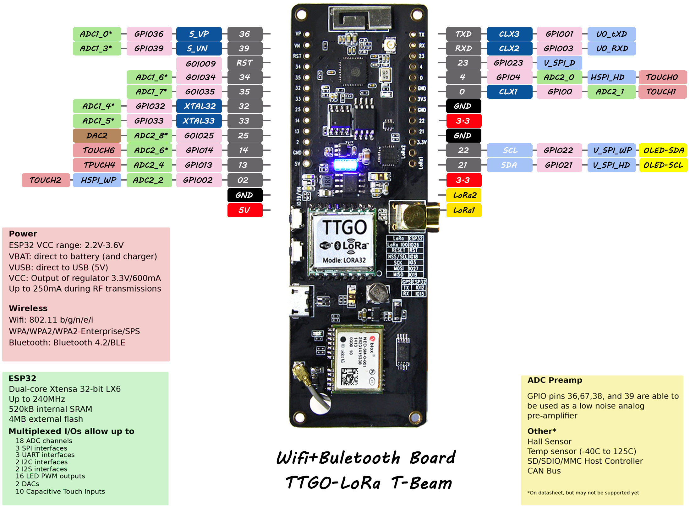
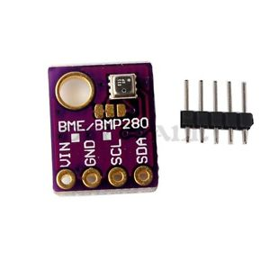

# TTGO T-Beam TTN LoRa GPS Vehicle Tracker

A GPS vehicle tracker for the **[TTGO T-Beam](https://github.com/LilyGO/TTGO-T-Beam)** (ESP32 + GPS + LoRa) that reports
over **The Things Network (TTN)** using LoRaWAN OTAA. It sends often while the vehicle moves, and sleeps
while it's parked, waking up for a heartbeat or as soon as an accelerometer feels motion.

The firmware is in [`MotionTracker/`](MotionTracker). The original fixed-rate sketches are still in the
repository root; see [Original sketches](#original-sketches).

## How it works

| State | What the tracker does | Uplink interval |
|-------|-----------------------|-----------------|
| **MOVING** | GPS on, sends position, speed, battery | 30–120 s (the faster it goes, the shorter the interval) |
| **STOPPED** | No motion from the accelerometer *and* GPS speed below 5 km/h for `STOP_TIMEOUT_S` (180 s) | One final "stopped" uplink, then deep sleep |
| **PARKED** | Deep sleep, LoRa radio and GPS powered off | Heartbeat every `HEARTBEAT_S` (default 600 s, pick 300–900 s) |

The tracker wakes from deep sleep when:

* the **accelerometer detects motion**: it powers up the GPS and goes to MOVING,
* the **heartbeat timer** runs out: it sends the last known position and goes back to sleep in a few seconds,
* the **middle user button** (GPIO 38) is pressed: it sends an uplink straight away.

A short bump, such as a door being closed, wakes the tracker but doesn't make it send anything. The first
MOVING uplink only goes out when GPS speed confirms the movement, or when the accelerometer still reports
motion after `GPS_FIX_WAIT_S`. Otherwise the tracker goes back to sleep once `STOP_TIMEOUT_S` has passed.

## What changed compared to the original sketch

The original `TTGO-T-Beam-TTN-LoRa-GPS-Vehicle-Tracker.ino` has these problems, all fixed here:

1. **It never sleeps.** GPS and LoRa stay on all the time, sending every 600 s while parked. `esp_sleep.h` is
   included but never used.
2. **The send rate follows the speed from the previous packet.** The next interval is picked in
   `EV_TXCOMPLETE` from the last `kmph`, so a car that starts moving waits up to 10 minutes before the
   first "moving" packet.
3. **Without a GPS fix, nothing is sent.** `do_send()` retries every 15 s indefinitely.
4. **The scheduling chain can die.** If `do_send()` finds `OP_TXRXPEND`, it returns without scheduling
   another send, so the tracker stops reporting.
5. **LMIC settings are applied before `os_init()`/`LMIC_reset()`**, which wipes them. `LMIC_setDrTxpow`,
   `LMIC_setLinkCheckMode` and the frame counter restore have no effect.
6. **The session keys are saved but never restored**, so every reboot means a new OTAA join.
7. **GPS reading blocks for 1 s** inside the LMIC job, and the tracker needs an AXP192. It doesn't run on the
   T-Beam v1.2, which has an AXP2101.

## Hardware

| Part | Needed | Notes |
|------|--------|-------|
| **TTGO T-Beam** v1.0, v1.1 (AXP192) or v1.2 (AXP2101) | Yes | Detected automatically |
| **LoRa antenna** and GPS antenna | Yes | Never transmit without the LoRa antenna |
| **Accelerometer**: LIS3DH or MPU-6050 | Strongly recommended | Wakes the tracker on motion; the T-Beam has none on board |
| **BME280** temperature / humidity / pressure | Optional | Off by default, see [Optional BME280](#optional-bme280) |
| 18650 Li-ion cell | For use without USB | Goes in the holder on the back |



### Accelerometer

The firmware detects which of these two is connected:

| Sensor | Sleep current | Notes |
|--------|---------------|-------|
| **LIS3DH** (recommended) | ~6 µA | Adafruit 2809, or generic LIS3DH boards |
| **MPU-6050 / GY-521** | ~20–70 µA | Cheap and common. It uses more power in sleep. |

If no accelerometer is found, the tracker still works: it wakes on the heartbeat timer, takes a GPS fix and
switches to MOVING if it has moved more than 100 m. Motion is then only noticed at the next heartbeat.

### Optional BME280

The BME280 reports the temperature, humidity and air pressure inside the vehicle. Its code is a separate
module (`MotionTracker/climate.cpp`) that is **off by default**. With it off, the firmware doesn't use or
need the BME280 library, and you can leave the sensor out entirely.

* **Turn it on:** set `#define USE_BME280 1` in `MotionTracker/config.h`, or build the
  `ttgo-t-beam-bme280` PlatformIO environment. In the Arduino IDE, also install the **Adafruit BME280 Library**.
* **Address:** most cheap boards use `0x76`; Adafruit boards use `0x77`. Set it with `BME280_ADDRESS`.
* **BME280, not BMP280:** the two look almost the same, but the BMP280 has no humidity sensor and isn't
  supported. The chip on a BME280 is square; on a BMP280 it is rectangular. With a BMP280 (or no sensor), the
  tracker logs `USE_BME280 is on but no BME280 found` and sends its uplinks without climate data.
* **Power:** the sensor runs in forced mode. It draws about 0.1 µA between readings, so it can stay powered
  in deep sleep. One reading is taken for every uplink.
* **Payload:** temperature, humidity and pressure go on channels 2, 3 and 4.
* The old BME280-I2C-ESP32 library from the original sketches isn't needed. MotionTracker uses the standard
  Adafruit library.



### Wiring

The accelerometer and the BME280 share the I2C bus on the T-Beam header:

```
Sensor pin       T-Beam
VCC / VIN   ->   3V3   (stays powered during deep sleep)
GND         ->   GND
SDA         ->   21
SCL         ->   22
INT / INT1  ->   13    (accelerometer only; ACCEL_INT_PIN in config.h, must be an RTC GPIO)
```

Most sensor boards already have I2C pull-up resistors. With long wires, add 2.2k–10k pull-ups on SDA and SCL.

## Installing on a TTGO T-Beam

> **Always screw the LoRa antenna on before powering the board.** Transmitting without an antenna can
> damage the radio. The GPS antenna (the small ceramic patch or the U.FL cable) should also be connected.

### 1. Find out which board you have

Look at the chip next to the battery holder, or check the print on the board:

* **v1.0 / v1.1**: AXP192 power chip, CP2104 USB chip.
* **v1.2**: AXP2101 power chip, CH9102 USB chip.

The firmware detects both. You only need to know this for the USB driver.

### 2. Register the device on The Things Network

1. Sign in to the [TTN console](https://console.cloud.thethings.network/) and pick your cluster
   (Europe 1 for the Netherlands).
2. **Applications → Create application**, give it an ID (for example `my-tracker`).
3. **Register end device → Enter end device specifics manually**:
   * Frequency plan: **Europe 863-870 MHz (SF9 for RX2 - recommended)** (or the plan for your region)
   * LoRaWAN version: **LoRaWAN Specification 1.0.3**
   * JoinEUI: all zeros is fine (`00 00 00 00 00 00 00 00`), then **Confirm**
   * DevEUI and AppKey: click **Generate** for both
4. Open the device page. For **DevEUI** and **JoinEUI**, click the `<>` button, switch to **lsb**, and copy the
   `{ 0x.., ... }` arrays into `LORAWAN_DEVEUI` and `LORAWAN_APPEUI` in `MotionTracker/config.h`.
   For **AppKey**, use `<>` with **msb** and paste it into `LORAWAN_APPKEY`.
5. **Payload formatters → Uplink → Formatter type: CayenneLPP → Save.** TTN then shows the decoded values
   (location, battery, speed, state) for every message.

### 3. Set up the build tools

**Option A: PlatformIO (easiest)**

1. Install [VS Code](https://code.visualstudio.com/) and the **PlatformIO IDE** extension.
2. **File → Open Folder** and select this repository (the folder that contains `platformio.ini`).
3. If you're not in Europe, change `CFG_eu868` in `platformio.ini` to your region (`CFG_us915`,
   `CFG_au915`, ...).

PlatformIO downloads the ESP32 toolchain and all libraries by itself.

**Option B: Arduino IDE 2**

1. **File → Preferences → Additional boards manager URLs**, add
   `https://espressif.github.io/arduino-esp32/package_esp32_index.json`.
2. **Tools → Board → Boards Manager**, install **esp32 by Espressif Systems**.
3. **Tools → Manage Libraries**, install **MCCI LoRaWAN LMIC library**, **TinyGPSPlus**, **CayenneLPP**
   (accept ArduinoJson as a dependency) and **XPowersLib**. Add **Adafruit BME280 Library** only if you use
   the BME280.
4. Select your region: open `Documents/Arduino/libraries/MCCI_LoRaWAN_LMIC_library/project_config/lmic_project_config.h`,
   comment out `#define CFG_us915 1` and uncomment `#define CFG_eu868 1` (or your region).
5. Open `MotionTracker/MotionTracker.ino`.
6. **Tools → Board → esp32 → T-Beam**.

### 4. Connect and flash

1. Install the USB driver if your computer doesn't see a new serial port: **CP210x** (Silicon Labs) for
   v1.0/v1.1, **CH9102/CH343** (WCH) for v1.2. Recent macOS and Linux usually need nothing.
2. Connect the T-Beam with a USB **data** cable (not a charge-only cable) and switch it on with the power button
   if needed.
3. Upload:
   * PlatformIO: click **Upload** in the status bar, or run `pio run -t upload` (use
     `pio run -e ttgo-t-beam-bme280 -t upload` for the BME280 version).
   * Arduino IDE: **Tools → Port** → the new serial port, then **Upload**.

   If the upload hangs at `Connecting...`, hold the **BOOT** button (GPIO 0, on the side) until the upload starts.

### 5. Check that it works

1. Open the serial monitor at **115200 baud** (`pio device monitor`, or **Tools → Serial Monitor**). After a
   reset you should see:
   ```
   MotionTracker boot #1, PMU AXP192, accel LIS3DH, wake cause 0
   State -> MOVING
   EV_JOINING
   EV_JOINED, devaddr=0x260B....
   Uplink queued: state=1 fix=1 ...
   EV_TXCOMPLETE
   ```
2. In the TTN console, the device's **Live data** tab shows the join and the uplinks.
3. The first GPS fix can take a few minutes outdoors. Indoors it may not come at all; the tracker then
   sends without position after `GPS_FIX_WAIT_S`.
4. Leave it still for `STOP_TIMEOUT_S` (3 minutes). It sends a "stopped" message (state 2) and prints
   `Deep sleep for up to 600 s`. Shake it and it wakes up straight away.

For desk testing, uncomment `#define DEBUG` in `config.h` to get shorter intervals.

## Configuration: `config.h`

* `LORAWAN_DEVEUI`, `LORAWAN_APPEUI` (LSB first) and `LORAWAN_APPKEY` (MSB first), from the TTN console.
* `MOVING_TX_MIN_S` / `MOVING_TX_MAX_S`: the interval range while moving (default 30/120 s).
* `HEARTBEAT_S`: the heartbeat interval while parked (default 600 s).
* `STOP_TIMEOUT_S`: how long without motion before the tracker counts as parked (default 180 s).
* `LIS3DH_MOTION_THRESHOLD` / `MPU6050_MOTION_THRESHOLD`: wake-up sensitivity. Raise them if wind or
  passing trucks wake the tracker.
* `HEARTBEAT_REFRESH_GPS`: set to 1 to take a new fix on every heartbeat instead of sending the cached
  position.
* `USE_BME280`: 1 to include the optional BME280 module, 0 to leave it out.
* `#define DEBUG`: short intervals for testing on the desk.

## Payload (Cayenne LPP, port 1)

The channels are the same as in the original sketches, so existing dashboards keep working. In the TTN
console, set **Payload formatters → Uplink** to **CayenneLPP** to decode them.

| Channel | Type | Content |
|---------|------|---------|
| 1 | GPS | latitude, longitude, altitude. Left out when moving without a fix. |
| 2 | Temperature | °C (only with `USE_BME280`) |
| 3 | Humidity | % (only with `USE_BME280`) |
| 4 | Barometer | hPa (only with `USE_BME280`) |
| 5 | Analog | battery voltage (V) |
| 6 | Analog | speed (km/h) |
| 7 | Analog | satellites in use |
| 8 | Digital | **new:** 0 = parked heartbeat, 1 = moving, 2 = just stopped |

## Notes

* The LoRaWAN session (keys, frame counters, channels and duty-cycle timers) is kept in RTC memory. The
  tracker only joins after power-up or a reflash, not on every wake.
* ADR is disabled and the data rate is fixed (SF7 by default, `LORAWAN_DATARATE`), which suits a device that moves.
* **TTN fair use policy:** 30 s of airtime per device per day. At SF7 one uplink of this size takes about 70 ms, so that is roughly
  430 uplinks per day. Driving for hours at 30 s intervals will go over it. Raise `MOVING_TX_MIN_S` if you
  drive a lot.

### Home Assistant and ESPHome

ESPHome can't be used for this tracker: it has no LoRaWAN support, so it can't join TTN. To get the data
into Home Assistant, keep this firmware and use Home Assistant's **The Things Network** integration, or TTN's
MQTT server with the MQTT integration.

## Original sketches

These are the original fixed-rate versions, kept for reference. They don't sleep.

* `TTGO-T-Beam-TTN-LoRa-GPS-Vehicle-Tracker.ino`: T-Beam v1.1 (AXP192). It reads a BME280 if one is
  connected, but the lines that add the climate values to the payload are commented out, so they aren't
  sent. Building it needs the [BME280-I2C-ESP32](https://github.com/Takatsuki0204/BME280-I2C-ESP32) library;
  uninstall the Adafruit BME280 library while using it, because the two conflict.
* `TTGO-T-Beam-TTN-LoRa-GPS-Vehicle-Trackerv07.ino`: T-Beam v0.7, without the BME280.

Both send every 10–15 minutes, or every 30–60 s when the last GPS speed was above 3.5–4 km/h. The keys go in
the `.ino` file itself.

The Arduino IDE builds every `.ino` file in a folder into one program, so copy the sketch you want into its
own folder, together with `gps.h` and `gps.cpp`, before you build it.

## TTGO T-Beam specifications

```
ESP32
  ESP32 Version REV1
  WiFi
  Bluetooth 
  4MB Flash
  3D Antenna
 
LORA
  Working voltage:      1.8 ~ 3.7v
  Acceptable current:   10 ~ 14mA
  Transmit current:     120mA @ +20dBm
                         90mA @ +17dBm
                         29mA @ +13dBm
  Operating frequency:  433MHz / 868MHz / 915MHz
  Transmit power:       +20dBm
  Receive sensitivity:  -139dBm @ LoRa &  62.5 KHz & SF=12 &  146bps
                        -136dBm @ LoRa & 125 KHz   & SF=12 &  293bps
                        -118dBm @ LoRa & 125 KHz   & SF=6  & 9380bps
                        -123dBm @ FSK  &   5 KHz   & 1.2Kbps
  Frequency error:       +/-15KHz
  FIFO space:            64 byte
  Data rate:             1.2K ~ 300Kbps @ FSK
                         0.018K ~ 37.5Kbps @ LoRa        
  Modulation Mode:       FSK, GFSK, MSK, GMSK, LoRa TM, OOK
  Interface form:        SPI
  Sleep current:         0.2uA @ SLEEP
                         1.5uA @ IDLE
  Operating temperature: -40? - +85?
  Digital RSSI function
  Automatic frequency correction
  Automatic gain control 
  RF wake-up function
  Low voltage detection and temperature sensor
  Fast wake-up and frequency hopping
  Highly configurable data packet handler

GPS
  GPS modules NEO-6M, 3V-5V power supply Universal
  Destined module with ceramic antenna, signal super
  Save the configuration parameter data EEPROM Down
  With data backup battery
  There are LED signal indicator
  Default Baud Rate: 9600

Power
  IP5306 2A Battery PMIC
  LED, Blue - User controller
  LED, Red - GPS 1PPS
  LED, Red/green - battery charged/power on
  Button, reset switch
  Button, user readable
  Switch, power on/battery charge
  USB
  CP2104-GMR
```

These specifications are for the early T-Beam. On v1.0 and later, the IP5306 is replaced by the AXP192
(AXP2101 on v1.2), and the GPS is usually a NEO-M8N.

## TODO

- Debug TTN downlink messages, there are a lot of frames down. Seems to come from the library but need to test this first
- Test MotionTracker on hardware and tune the default motion thresholds

## Credits

- Thanks to [Tekk](https://github.com/tekk) for his [TTGO-T-Beam-Car-Tracker](https://github.com/tekk/TTGO-T-Beam-Car-Tracker) which came as an inspiration for this project
- Thanks [Matthijs Kooijman](https://github.com/matthijskooijman/arduino-lmic/tree/master/examples/ttn-otaa) for his OTAA example for The Things Network
- Thanks to [DeuxVis](https://github.com/DeuxVis) for his [Lora-TTNMapper-T-Beam](https://github.com/DeuxVis/Lora-TTNMapper-T-Beam) which formed inspiration for Tekk's repository
- GPS power management based on the code provided by [LilyGO](https://github.com/LilyGO/TTGO-T-Beam/blob/master/GPS-T22_v1.0-20190612/GPS-T22_v1.0-20190612.ino)

## Further improvement

You are welcome to contribute to this project in any way. (Submit an issue, bug report, fork and improve...)
Suggestions & feedback is much appreciated.
